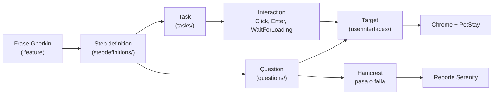

# PetStay · Automatización de pruebas Front-End con Serenity BDD

Pruebas end-to-end de **PetStay** (hotel para mascotas, <https://petstay-aphn.onrender.com>) escritas en
**Gherkin (español)** con **Serenity BDD + Cucumber** y el patrón de diseño **Screenplay**.

[](https://github.com/criskian/petstay-serenity-bdd/actions/workflows/ci.yml)

| | |
|---|---|
| **Aplicación bajo prueba** | PetStay (Render). Todo el estado vive en `localStorage` del navegador |
| **Escenarios** | 28 escenarios (36 ejecuciones con las filas de los *Esquemas del escenario*): positivos y negativos |
| **Trazabilidad** | Requisito (`@HU-0X`) → Issue de GitHub (`@issue:N`) → Escenario → Reporte |
| **Tablero (GitHub Project)** | [PetStay - Trazabilidad de pruebas](https://github.com/users/criskian/projects/6): requisitos, casos de prueba y defectos |
| **Reporte publicado** | <https://criskian.github.io/petstay-serenity-bdd/> |
| **Pipeline** | GitHub Actions: ejecuta en Chrome headless y publica el reporte en GitHub Pages |

## Contenido

1. [Qué se automatiza y cómo se lee este proyecto](#1-qué-se-automatiza-y-cómo-se-lee-este-proyecto)
2. [Conceptos clave](#2-conceptos-clave)
3. [Requisitos y ejecución](#3-requisitos-y-ejecución)
4. [Arquitectura (patrón Screenplay)](#4-arquitectura-patrón-screenplay)
5. [Recorrido de una frase de punta a punta](#5-recorrido-de-una-frase-de-punta-a-punta)
6. [Gherkin: los escenarios](#6-gherkin-los-escenarios)
7. [Archivos de arranque y configuración](#7-archivos-de-arranque-y-configuración)
8. [Localizadores](#8-localizadores)
9. [Decisiones de diseño y problemas resueltos](#9-decisiones-de-diseño-y-problemas-resueltos)
10. [Trazabilidad: requisito → issue → escenario](#10-trazabilidad-requisito--issue--escenario)
11. [Defecto encontrado en la aplicación](#11-defecto-encontrado-en-la-aplicación)
12. [Pipeline (GitHub Actions)](#12-pipeline-github-actions)
13. [Guía para la sustentación](#13-guía-para-la-sustentación)

---

## 1. Qué se automatiza y cómo se lee este proyecto

PetStay permite a un dueño de mascota **iniciar sesión, registrar mascotas, reservar una estadía con servicios
adicionales y cancelarla con reembolso**. Las pruebas hacen lo mismo que haría una persona en el navegador y comprueban
los mensajes, totales y estados que muestra la aplicación.

Reglas de negocio de PetStay que cubren los escenarios:

| Tema | Regla |
|---|---|
| Sesión | Usuario de práctica `dueno` / `huellitas123`. Sin sesión, las pantallas internas redirigen al ingreso |
| Tamaño de la mascota | Pequeño hasta 10 kg, Mediano hasta menos de 25 kg, Grande desde 25 kg |
| Validaciones de mascota | Vacunas al día obligatorias, peso mayor que 0 y máximo 80 kg, edad entre 0 y 25 años, nombre no repetido (sin distinguir mayúsculas) |
| Precio por noche | Pequeño $40.000, Mediano $55.000 |
| Servicios | Baño y peluquería $25.000; paseo diario $10.000 por noche (solo perros) |
| Descuento | 15 % sobre el alojamiento desde 7 noches |
| Reserva | Entrada no anterior a hoy, salida posterior a la entrada, máximo 30 noches, sin cruce con otra reserva activa de la misma mascota |
| Cancelación | 3 días o más antes: reembolso 100 %. 1 o 2 días: 50 %. El mismo día: 0 % |

> Los requisitos **HU-01 a HU-05** se derivaron del comportamiento observado de la aplicación al explorarla.

**Cómo leerlo:** empieza por un `.feature` (qué se prueba, en lenguaje de negocio), sigue la frase hasta su *step definition*
y desde ahí baja por Task → Interaction → Target. La sección 5 hace ese recorrido completo con dos ejemplos.

## 2. Conceptos clave

| Concepto | En palabras simples |
|---|---|
| **Gherkin** | Lenguaje de los `.feature`: *Dado… Cuando… Entonces…*. Lo puede leer alguien que no programa |
| **Cucumber** | Lee los `.feature` y, para cada frase, ejecuta el método Java que le corresponde |
| **Serenity BDD** | Coordina la ejecución, toma capturas de pantalla y genera el reporte. Trae el patrón Screenplay |
| **Selenium / WebDriver** | Controla el navegador (escribir, hacer clic, leer textos). Serenity lo usa por debajo |
| **Screenplay** | Patrón que describe la prueba como un **actor** que hace **tareas** y **observa** resultados |
| **Actor** | Quién hace la prueba. Aquí, el **Dueño** de la mascota |
| **Ability** | Lo que el actor puede hacer. `BrowseTheWeb` = usar un navegador |
| **Task** | Acción de negocio: "inicia sesión", "registra una mascota" |
| **Interaction** | Acción pequeña: un clic, escribir un texto, esperar |
| **Question** | Lo que el actor observa para verificar un resultado |
| **Target** | Dónde está un elemento en la página (un localizador con nombre) |
| **Tag** | Etiqueta con `@` sobre un escenario (`@issue:11`, `@positivo`, `@HU-02`) para clasificar y filtrar la ejecución |
| **Issue** | Ficha en GitHub: requisito, caso de prueba o defecto |
| **Pipeline** | Receta de GitHub Actions que instala, ejecuta las pruebas y publica el reporte |
| **Headless** | Chrome sin ventana visible (así corre en el pipeline) |
| **Hamcrest** | Librería de comparadores legibles (`equalTo`, `containsString`, `hasItem`…) para verificar |

## 3. Requisitos y ejecución

- JDK 17 o superior (se probó en local con 21; el pipeline usa 17)
- Google Chrome (Selenium Manager descarga el driver automáticamente)
- No hace falta instalar Gradle: se usa el wrapper (`gradlew`)

### Comandos

```bash
# Toda la suite (abre Chrome visible)
./gradlew clean test

# Sin ventana de navegador (como en el pipeline)
./gradlew clean test -Dheadless.mode=true

# Más rápido en desarrollo: capturas solo cuando algo falla
./gradlew test -Dheadless.mode=true -Dserenity.take.screenshots=FOR_FAILURES
```

En **Windows PowerShell** cada propiedad `-D` va completa entre comillas, porque si no PowerShell la parte en el punto:

```powershell
.\gradlew.bat test "-Dcucumber.filter.tags=@issue:11"
```

El reporte HTML con capturas de cada paso queda en `target/site/serenity/index.html`.

> Sin filtro de tags, el escenario **#26** sale en rojo: es el defecto conocido de la aplicación (ver sección 11).
> El resultado esperado de la suite completa es 35 de 36 ejecuciones en verde y el #26 fallando. Para verla toda en verde
> usa `-Dcucumber.filter.tags="not @defecto-conocido"`.

La primera ejecución descarga las dependencias de Gradle y tarda más. Con una captura por cada acción (valor por defecto),
cada escenario tarda entre 20 y 65 s en local; por eso conviene `FOR_FAILURES` para ensayar.

### Ejecutar una parte de la suite (por tags)

Los tags permiten ejecutar un caso de prueba concreto "desde su issue", un requisito completo o un tipo de escenario:

```bash
./gradlew test -Dcucumber.filter.tags="@issue:11"          # un caso de prueba (issue #11)
./gradlew test -Dcucumber.filter.tags="@HU-03"             # todos los escenarios de un requisito
./gradlew test -Dcucumber.filter.tags="@smoke"             # pruebas rápidas de humo
./gradlew test -Dcucumber.filter.tags="@negativo"          # solo escenarios negativos
./gradlew test -Dcucumber.filter.tags="@HU-02 and @negativo"
./gradlew test -Dcucumber.filter.tags="not @defecto-conocido"
```

Otros parámetros: `-Dpetstay.base.url=<otra URL>`, `-Dwebdriver.driver=edge|firefox`.

**Desde GitHub:** *Actions → Pruebas Front-End (Serenity BDD) → Run workflow* y escribir el filtro (por ejemplo `@issue:11`)
en el campo `tags`. Vacío ejecuta todo.

> Las propiedades `-D` que llegan a las pruebas son solo las que enumera `build.gradle` (`headless.mode`, `webdriver.driver`,
> `environment`, `petstay.base.url`, `cucumber.filter.tags`, `serenity.take.screenshots`). Una propiedad nueva debe agregarse a esa lista.

## 4. Arquitectura (patrón Screenplay)

Screenplay describe las pruebas desde el punto de vista de **quién** hace **qué** y **qué observa**,
en lugar de "qué botón se pulsa" (Page Object). Cada concepto tiene su propia clase pequeña y reutilizable:

```
src/test/
├── resources/
│   ├── serenity.conf                  ← Configuración (URL, navegador, capturas, enlace a issues)
│   └── features/                      ← Escenarios en Gherkin (QUÉ se prueba, en lenguaje de negocio)
│       ├── autenticacion/login.feature
│       ├── mascotas/registro_mascotas.feature
│       ├── reservas/reserva_estadia.feature
│       ├── servicios/servicios_adicionales.feature
│       └── cancelaciones/cancelacion_reservas.feature
└── java/
    ├── runners/Runner.java            ← Punto de entrada: une Cucumber con Serenity
    ├── stepdefinitions/               ← Traducen cada frase Gherkin a Tasks y Questions
    ├── tasks/                         ← Lo que el actor HACE (Login, RegisterPet, BookStay…)
    ├── interactions/                  ← Acciones de bajo nivel propias (WaitForLoading, SelectPet…)
    ├── questions/                     ← Lo que el actor OBSERVA (VisibleText, ElementState, RegisteredPets…)
    ├── userinterfaces/                ← Targets: DÓNDE está cada elemento (localizadores)
    ├── models/                        ← Datos de los formularios (PetData, StayData)
    └── utils/                         ← Config (URL) y Fechas ("dentro de 5 días" → DD/MM/AAAA)
```



### Qué contiene cada carpeta

| Carpeta | Archivos | Para qué sirven |
|---|---|---|
| `runners/` | `Runner` | Punto de entrada. `features` indica dónde están los `.feature` y `glue` dónde está el código de cada frase |
| `stepdefinitions/` | `Hooks`, `LoginSteps`, `PetSteps`, `BookingSteps`, `ReservationSteps` | Cada método lleva la frase exacta del `.feature` (`@Dado`, `@Cuando`, `@Entonces`) y solo delega en una Task o una Question. `Hooks` crea al actor antes de cada escenario y limpia el navegador después |
| `tasks/` | `OpenApp`, `Login`, `Logout`, `NavigateTo`, `RegisterPet`, `BookStay`, `CancelReservation` | Acciones de negocio. Cada una agrupa pasos bajo una frase que aparece en el reporte |
| `interactions/` | `WaitForLoading`, `SelectPet`, `RememberReservationCode` | Acciones pequeñas que Serenity no trae: esperar la capa de carga, elegir una mascota en la lista desplegable y recordar el código de reserva |
| `questions/` | `VisibleText`, `ElementState`, `CurrentPage`, `RegisteredPets`, `SelectedPet` | Lo que el actor lee de la página para verificar |
| `userinterfaces/` | `LoginPage`, `Header`, `PetsPage`, `BookingPage`, `ReservationsPage`, `FormFields` | Un localizador con nombre (Target) por cada elemento, agrupados por pantalla |
| `models/` | `PetData`, `StayData` | Datos de los formularios como `record` de Java (inmutables) |
| `utils/` | `Config`, `Fechas` | URL base de la app y conversión de fechas relativas |

**Tasks del proyecto**

| Task | Qué hace |
|---|---|
| `OpenApp` | Abre una página de PetStay (`index.html` u otra) |
| `Login` | Escribe usuario y clave, hace clic en Ingresar y espera la carga |
| `Logout` | Clic en "Cerrar sesión" |
| `NavigateTo` | Entra a Mis mascotas, Reservar o Mis reservas por el menú, como lo haría una persona |
| `RegisterPet` | Llena y envía el formulario de mascotas. Arma los pasos según los datos (sin especie no marca radio, sin vacunas no marca la casilla), así sirve para el caso feliz y los negativos |
| `BookStay` | Piezas pequeñas: `fillingForm`, `addingBathService`, `addingWalkService`, `calculatingTotal`, `confirming` y `completeBooking` (las junta) |
| `CancelReservation` | `opening(código)`, `confirming()` y `dismissing()` |

**Questions del proyecto**

| Question | Responde | ¿Espera? | Se usa para |
|---|---|---|---|
| `VisibleText.of(target)` | El texto de un elemento | Sí, hasta que sea visible | Mensajes, totales, noches, saludo |
| `ElementState.isVisible / isEnabled` | Si se ve o está habilitado | No | Verificaciones negativas ("no aparece el descuento") |
| `CurrentPage.title() / url()` | Título (h1) o URL actual | — | Saber en qué pantalla está el actor |
| `RegisteredPets.names()` | Nombres en la tabla de mascotas | No (JavaScript) | "La mascota aparece / no aparece" |
| `SelectedPet.inBookingForm()` | Mascota seleccionada en el formulario | — | Comprobar la preselección desde "Reservar" |

## 5. Recorrido de una frase de punta a punta

### Ejemplo 1: inicio de sesión (issue #6)

```gherkin
@issue:6 @positivo @smoke
Escenario: Inicio de sesión exitoso con credenciales válidas
  Dado que el dueño abre la aplicación PetStay
  Cuando inicia sesión con el usuario "dueno" y la contraseña "huellitas123"
  Entonces ve la pantalla "Mis mascotas"
  Y el saludo muestra al usuario "dueno"
```

| Momento | Qué ocurre |
|---|---|
| `@Before` (`Hooks.prepararEscenario`) | Se crea el escenario de Screenplay y el actor "Dueño" con la habilidad `BrowseTheWeb` (su Chrome) |
| *Dado que abre la aplicación* | `LoginSteps.queElDuenoAbreLaAplicacion()` → `OpenApp.onLoginPage()` → `Open.url(Config.urlDe("index.html"))` |
| *Cuando inicia sesión…* | `LoginSteps.iniciaSesionCon(usuario, clave)` → `Login.withCredentials(...)`: `Enter` en `input[name='usuario']`, `Enter` en `#pass-01`, `Click` en `[data-testid='btn-ingresar']` y `WaitForLoading` |
| *Entonces ve la pantalla…* | `seeThat(CurrentPage.title(), equalTo(titulo))`: lee el `main h1` y lo compara |
| *Y el saludo muestra…* | `seeThat(VisibleText.of(Header.SALUDO), equalTo(usuario))` |
| `@After` (`Hooks.limpiarDatosDelNavegador`) | Borra localStorage, sessionStorage y cookies, pase o falle el escenario |

### Ejemplo 2: calcular el total de una reserva (issue #17)

`Cuando calcula el total`:

| Capa | Archivo | Qué hace |
|---|---|---|
| Gherkin | `features/reservas/reserva_estadia.feature` | Describe el comportamiento en lenguaje de negocio |
| Step definition | `stepdefinitions/BookingSteps.java` → `calculaElTotal()` | Une la frase con el código |
| Task | `tasks/BookStay.java` → `calculatingTotal()` | Lo que el actor **hace** |
| Interaction | `Click.on(...)` (de Serenity) | Acción de bajo nivel |
| Target | `userinterfaces/BookingPage.java` → `CALCULAR` (`#btn-calcular`) | **Dónde** está el botón |
| Question | `questions/VisibleText.java` + `seeThat(...)` | Lo que el actor **observa** y verifica |

La frase `completa la reserva de "Rocky" con entrada "dentro de 5 días" por 3 noches` además usa `Fechas.interpretar`
(convierte "dentro de 5 días" a `DD/MM/AAAA`) y `Fechas.sumarNoches` (calcula la salida) antes de llamar a `BookStay.fillingForm`.
El total esperado, `$165.000`, es 3 noches × $55.000 (Rocky, 15 kg, es Mediano).

## 6. Gherkin: los escenarios

### Palabras clave (se usa `# language: es`)

| Español | Inglés | Para qué sirve |
|---|---|---|
| `Característica` | Feature | Tema del archivo, con la historia *Como… Quiero… Para…* |
| `Antecedentes` | Background | Pasos que se repiten al inicio de cada escenario del archivo |
| `Escenario` | Scenario | Un caso de prueba |
| `Esquema del escenario` + `Ejemplos` | Scenario Outline + Examples | Un escenario con variables `<así>` que se ejecuta una vez por cada fila |
| `Dado` / `Cuando` / `Entonces` / `Y` | Given / When / Then / And | Precondición, acción, verificación |

### Los cinco features

| Archivo | Requisito | Escenarios | Qué cubre |
|---|---|---|---|
| `autenticacion/login.feature` | `@HU-01` | 5 | Login correcto, clave incorrecta, campos vacíos, acceso sin sesión, cerrar sesión |
| `mascotas/registro_mascotas.feature` | `@HU-02` | 6 | Registro, tamaño por peso (5 filas), sin vacunas, formulario vacío, nombre duplicado, peso/edad inválidos (4 filas) |
| `reservas/reserva_estadia.feature` | `@HU-03` | 8 | Total, confirmar con código, fecha pasada, salida inválida (2 filas), más de 30 noches, cruce de reservas, formulario vacío, atajo "Reservar" |
| `servicios/servicios_adicionales.feature` | `@HU-04` | 5 | Descuento desde 7 noches (2 escenarios), baño, baño + paseo (defecto), paseo no disponible para gatos |
| `cancelaciones/cancelacion_reservas.feature` | `@HU-05` | 4 | Reembolso 100 %, 50 %, 0 %, desistir de cancelar |

28 escenarios y 36 ejecuciones: tres esquemas (#12, #16 y #20) se ejecutan una vez por fila (5 + 4 + 2 = 11 ejecuciones en lugar de 3).

### Los tags

| Tag | Nivel | Significado |
|---|---|---|
| `@HU-0X` | Característica | Requisito al que pertenece el escenario |
| `@issue:N` | Escenario | Número del issue del caso de prueba (se vuelve enlace en el reporte) |
| `@positivo` / `@negativo` | Escenario | Todo correcto y debe funcionar / algo incorrecto y debe rechazarse |
| `@smoke` | Escenario | Funciones principales, de ejecución rápida |
| `@defecto-conocido` | Escenario | Describe el comportamiento correcto de una función que hoy está rota en la app |

### Cómo se conecta una frase con el código

```java
@Cuando("completa la reserva de {string} con entrada {string} por {int} noches")
public void completaLaReservaConEntradaPorNoches(String mascota, String entrada, int noches) { ... }
```

`{string}` captura un texto entre comillas y `{int}` un entero. El texto de la anotación debe coincidir **exactamente**
con la frase del `.feature` (incluidas las tildes); si no, Cucumber marca el paso como indefinido y propone un snippet.
Los pasos con tabla (`registra una mascota con los siguientes datos:`) reciben un `DataTable`.

## 7. Archivos de arranque y configuración

**`Runner.java`**

```java
@RunWith(CucumberWithSerenity.class)
@CucumberOptions(
        plugin = "pretty",
        features = "src/test/resources/features",   // dónde están los .feature
        glue = "stepdefinitions",                   // dónde está el código de cada frase
        snippets = CucumberOptions.SnippetType.CAMELCASE
)
public class Runner { }
```

Usa JUnit 4 (`@RunWith`), por eso `build.gradle` incluye `junit-vintage-engine`.

**`Hooks.java`**: `@Before` crea el escenario (`OnStage.setTheStage(new OnlineCast())`) y al actor "Dueño";
`@After` limpia localStorage, sessionStorage y cookies para que cada escenario sea independiente.

**`serenity.conf`**

| Propiedad | Qué hace |
|---|---|
| `petstay.base.url` | Dirección de la app (se sobrescribe con `-Dpetstay.base.url=…`) |
| `headless.mode = false` | Por defecto se ve el navegador; el pipeline usa `-Dheadless.mode=true` |
| `take.screenshots = FOR_EACH_ACTION` | Una captura por acción (documentación viva). `FOR_FAILURES` para ir más rápido |
| `restart.browser.for.each = scenario` | Navegador nuevo por escenario |
| `issue.tracker.url` | Convierte `@issue:N` en un enlace a `…/issues/N` en el reporte |
| `webdriver.timeouts.implicitlywait = 15000` | Segundos que Selenium espera a que aparezca un elemento |
| `webdriver.timeouts.pageload = 90000` | Margen para que Render "despierte" la app gratuita |
| `environments { chrome, edge, firefox }` | Opciones de cada navegador (`-Dwebdriver.driver=edge`) |

**`build.gradle`**: plugin `net.serenity-bdd.serenity-gradle-plugin` 4.2.32 (aporta la tarea `aggregate` que arma el reporte),
una sola versión de Serenity para todas las librerías, Hamcrest 2.2 para las verificaciones, y `finalizedBy(aggregate)` para
que el reporte se genere siempre, incluso si algún escenario falla.

## 8. Localizadores

Cada Target se define así:

```java
// CSS: un solo elemento
public static final Target CALCULAR = Target.the("botón Calcular total")
        .located(By.cssSelector("#btn-calcular"));

// XPath con una parte variable {0}
public static final Target TAMANO_DE = Target.the("tamaño de la mascota {0}")
        .locatedBy("//td[@class='nombre'][normalize-space()='{0}']/following-sibling::td[4]");

// Se usa con .of("valor") para rellenar {0}
Text.of(PetsPage.TAMANO_DE.of("Rocky"))
```

> `.located(By.cssSelector(...))` es CSS; `.locatedBy("//...")` interpreta el texto como **XPath**. Pasarle un CSS a `locatedBy` falla.

Se prefiere el atributo más estable que ofrezca cada elemento: `id` → `data-testid` → `name` → `aria-label` → clase → texto.
XPath se reserva para recorrer tablas (`following-sibling`) o buscar por texto (`normalize-space()`). Se evitan rutas absolutas.

| Pantalla | Elemento | Localizador |
|---|---|---|
| **Login** (`LoginPage`) | Usuario | `input[name='usuario']` |
| | Contraseña | `#pass-01` |
| | Botón Ingresar | `[data-testid='btn-ingresar']` |
| | Error de login | `#error-login` |
| **Encabezado** (`Header`) | Saludo | `header.barra .saludo strong` |
| | Cerrar sesión | `button[name='cerrar-sesion']` |
| | Enlace del menú | `//nav[@aria-label='Menú principal']//a[normalize-space()='{0}']` |
| | Capa de carga | `#capa-cargando` |
| | Título de página | `main h1` |
| **Mascotas** (`PetsPage`) | Nombre | `#nombreMascota` |
| | Especie (radio) | `//input[@name='especie' and @value='{0}']` |
| | Peso | `input[name='peso']` |
| | Edad | `[data-testid='edad']` |
| | Vacunas | `input[name='vacunas']` |
| | Botón Registrar | `//form[@id='form-mascota']//button[@type='submit']` |
| | Mensaje | `[data-testid='mensaje-mascotas']` |
| | Nombres en la tabla | `#tabla-mascotas tbody td.nombre` |
| | Especie / peso / tamaño de X | `//td[@class='nombre'][normalize-space()='{0}']/following-sibling::td[1]`, `[2]`, `[4]` |
| **Errores de campo** (`FormFields`) | Error del campo X | `//span[contains(@class,'error-campo')][@data-campo='{0}']` |
| **Reserva** (`BookingPage`) | Lista de mascotas | `select[name='mascota']` |
| | Fecha de entrada / salida | `#fecha-entrada` / `[data-testid='fecha-salida']` |
| | Servicio baño / paseo | `#srv-bano` / `input[name='paseo']` |
| | Calcular | `#btn-calcular` |
| | Confirmar | `.panel-resumen .btn-primario` |
| | Resumen: noches, descuento, total | `[data-testid='res-noches']`, `[data-testid='res-descuento']`, `[data-testid='res-total']` |
| | Mensaje y código | `[data-testid='mensaje-reserva']`, `[data-testid='codigo-reserva']` |
| **Mis reservas** (`ReservationsPage`) | Mascota, total, estado, reembolso de la reserva X | `//td[@class='codigo'][normalize-space()='{0}']/following-sibling::td…` |
| | Botón Cancelar | `//button[@aria-label='Cancelar reserva {0}']` |
| | Diálogo y texto | `.modal`, `.modal .texto-modal` |
| | Sí, cancelar / No, volver | `#confirmar-cancelacion` / `.modal [data-accion='volver']` |

**Cómo obtener un localizador a mano:** abrir la página, `F12` → pestaña *Elements*, seleccionar el elemento con la flecha,
leer sus atributos y escribir el CSS o XPath. Se prueba con `Ctrl+F` dentro de *Elements* (debe decir "1 of 1") o en la pestaña
*Console* con `$$("#btn-calcular")` (CSS) y `$x("//button[@id='btn-calcular']")` (XPath).

## 9. Decisiones de diseño y problemas resueltos

- **Espera explícita al overlay de carga.** PetStay simula procesos lentos con una capa que tapa la pantalla durante
  0,3–1,5 s (tiempo aleatorio). `WaitForLoading` consulta el DOM con JavaScript (`FluentWait`, cada 100 ms, máximo 20 s)
  hasta que desaparece; no se usan `sleep` ni `WaitUntil(isNotVisible)`, que tardaría todo el timeout implícito cuando la capa no existe.
- **Fechas relativas.** Los escenarios dicen `"dentro de 5 días"`, `"ayer"` u `"hoy"`, así nunca caducan.
  `Fechas.interpretar` acepta `hoy`, `ayer`, `mañana`, `dentro de N días` y `hace N días`; cualquier otro texto pasa tal cual
  (permite probar fechas inválidas).
- **Independencia entre escenarios.** El hook `@After` limpia `localStorage` y cookies; si no, un escenario heredaría
  la sesión y las mascotas del anterior.
- **Lectura sin condiciones de carrera.** `VisibleText` espera a que el mensaje deje de estar oculto (`[hidden]`)
  antes de leer su texto; `ElementState` y `RegisteredPets` consultan sin esperar para las verificaciones negativas
  (esperar a algo que nunca aparecerá costaría todo el timeout).
- **Interacciones instrumentadas.** Las interacciones propias llevan `@Step` y se crean con `Tasks.instrumented(...)`;
  creadas con `new` Serenity no las instrumenta y fallan con un error de nulo.
- **Memoria del actor.** El código de reserva (`PS-XXXX`) es aleatorio: `RememberReservationCode` lo guarda con
  `actor.remember(...)` al confirmar y los pasos posteriores lo recuperan con `actor.recall(...)`.
- **Una sola tabla de datos para el registro.** El paso `registra una mascota con los siguientes datos:` cubre el caso feliz y
  los negativos: una celda vacía deja el campo en blanco y la columna `vacunas` admite `sí` o `no`.
- **Localizadores variados a propósito**, según lo mejor que ofrezca cada elemento: `data-testid`, `name`, `id`,
  `aria-label` y XPath con `following-sibling` para leer celdas de las tablas por nombre o código.
- **Credenciales fuera del reporte.** La descripción de la tarea `Login` no incluye la contraseña.

| Problema encontrado | Causa | Solución |
|---|---|---|
| Un localizador CSS no encontraba el elemento | `locatedBy` interpreta el texto como XPath | CSS con `.located(By.cssSelector(...))`, XPath con `.locatedBy(...)` |
| Error de nulo en interacciones propias | Clase con `@Step` creada con `new` | `Tasks.instrumented(...)` |
| Cada escenario tardaba ~30 s de más | `WaitUntil(isNotVisible)` esperaba 15 s por una capa inexistente | `WaitForLoading` con JavaScript |
| Clics que fallaban a veces | La capa de carga tapaba el botón | Espera explícita tras cada acción que la dispara |
| 9 escenarios no encontraban el campo de login | El navegador se reutilizaba con la sesión anterior en localStorage | Hook `@After` que limpia el estado del navegador |
| Mensajes leídos como vacíos | Estaban ocultos hasta terminar de procesar | `VisibleText` espera visibilidad antes de leer |
| Fallo de red al crear los issues en GitHub | Tiempo de espera TLS | Script idempotente con reintentos |

## 10. Trazabilidad: requisito → issue → escenario

Cada requisito es un issue con la etiqueta `requirement` y cada caso de prueba es un issue con la etiqueta
`test-case` que apunta a su requisito. En el `.feature`:

```gherkin
@HU-02 @mascotas                              ← requisito (a nivel de Característica)
Característica: HU-02 Registro de mascotas

  @issue:11 @positivo @smoke                  ← issue del caso de prueba + tipo
  Escenario: Registro exitoso de una mascota con datos válidos
```

Serenity convierte `@issue:N` en un enlace al issue de GitHub dentro del reporte
(`serenity.issue.tracker.url` en `serenity.conf`) y agrupa los resultados por requisito.

| Tipo de issue | Números | Etiquetas |
|---|---|---|
| Requisitos | #1 a #5 (HU-01 a HU-05) | `requirement` |
| Casos de prueba | #6 a #31 y #33 (TC-n = issue n + 5) | `test-case`, `positivo`/`negativo`, `HU-0X` |
| Defecto | #32 | `bug` |

| Requisito | Casos de prueba (issues) |
|---|---|
| [#1 HU-01 Inicio de sesión](https://github.com/criskian/petstay-serenity-bdd/issues/1) | #6 login exitoso · #7 contraseña incorrecta · #8 campos vacíos · #9 pantalla interna sin sesión · #10 cerrar sesión |
| [#2 HU-02 Registro de mascotas](https://github.com/criskian/petstay-serenity-bdd/issues/2) | #11 registro exitoso · #12 clasificación de tamaño (5 ejemplos) · #13 sin vacunas · #14 formulario vacío · #15 nombre duplicado · #16 peso/edad fuera de rango (4 ejemplos) |
| [#3 HU-03 Reserva de estadía](https://github.com/criskian/petstay-serenity-bdd/issues/3) | #17 cálculo del total · #18 confirmar y ver en Mis reservas · #19 entrada en el pasado · #20 salida igual/anterior (2 ejemplos) · #21 más de 30 noches · #22 cruce de reservas · #23 formulario vacío · #24 atajo Reservar |
| [#4 HU-04 Servicios y descuentos](https://github.com/criskian/petstay-serenity-bdd/issues/4) | #25 descuento desde 7 noches (2 escenarios) · #33 total con baño · #26 total con baño y paseo ⚠️ · #27 paseo no disponible para gatos |
| [#5 HU-05 Cancelación](https://github.com/criskian/petstay-serenity-bdd/issues/5) | #28 reembolso 100 % · #29 reembolso 50 % · #30 sin reembolso · #31 desistir de cancelar |

El [GitHub Project](https://github.com/users/criskian/projects/6) reúne los 33 issues con su estado (*Done* los que pasan,
*Todo* el #26 y el defecto #32).

**Ejecutar un caso desde su issue:** el número del issue es el filtro de tags, `-Dcucumber.filter.tags="@issue:N"`, en local
o en el campo `tags` de *Run workflow* en GitHub Actions.

## 11. Defecto encontrado en la aplicación

El escenario **#26** falla a propósito: es la evidencia del defecto [#32](https://github.com/criskian/petstay-serenity-bdd/issues/32).
La pantalla anuncia *"Paseo diario — $10.000 por noche"*, pero el total solo suma $10.000 una vez.

| Cálculo (Rocky, Mediano, 2 noches) | Valor |
|---|---|
| Alojamiento: 2 × $55.000 | $110.000 |
| + Baño y peluquería | $25.000 → **$135.000** (escenario #33, pasa) |
| + Paseo diario por noche (2 × $10.000) | **$155.000 esperado** |
| Lo que calcula la aplicación (paseo una sola vez) | **$145.000** |

El escenario describe el comportamiento correcto del requisito, no el actual de la app, y por eso está marcado
con `@defecto-conocido`. Cambiar el valor esperado para que pasara dejaría de proteger al usuario.

## 12. Pipeline (GitHub Actions)

`.github/workflows/ci.yml` se dispara en cada `push`/`pull_request` a `main` y manualmente
(*Actions → Run workflow*, con un filtro de tags opcional).

| Paso | Qué hace |
|---|---|
| `actions/checkout@v4` | Descarga el código |
| `actions/setup-java@v4` | Instala Java 17 (Temurin) con caché de Gradle |
| Despertar la aplicación | `curl` con reintentos: Render duerme el servicio gratuito y el primer acceso tarda |
| Ejecutar pruebas | `./gradlew clean test -Dheadless.mode=true -Dcucumber.filter.tags="…"`; sin filtro usa `not @defecto-conocido` |
| Evidencia del defecto conocido | Corre aparte `@defecto-conocido` con `continue-on-error`: queda en el reporte sin poner el pipeline en rojo |
| Resumen de resultados | Escribe el resumen de Serenity en la página de la ejecución |
| `upload-artifact@v4` | Guarda el reporte como artefacto `reporte-serenity` (30 días) |
| `upload-pages-artifact` + `deploy-pages` | Publica el reporte en GitHub Pages |

Los pasos de reporte llevan `if: always()`, así el reporte existe aunque algún escenario falle. El bloque `concurrency`
cancela una ejecución anterior si llega otro `push`, y `permissions` se limita a leer código y publicar en Pages.

Se excluye `@defecto-conocido` de la corrida principal para que un rojo signifique "se rompió algo nuevo" y no "el defecto
conocido sigue ahí".

## 13. Guía para la sustentación

### Qué se puede pedir y dónde está

| Pedido | Dónde mirar en este README |
|---|---|
| Explicar un *feature* o un *scenario* | Secciones 5 y 6 |
| Explicar Screenplay y su uso en Serenity | Secciones 2, 4 y 5 |
| Trazabilidad e issues | Sección 10 |
| Ejecutar escenarios desde el TestCase | Sección 3 (tags) y sección 10 |
| Cambiar un elemento de la automatización en vivo | "Cambios en vivo" (abajo) |
| Escribir un localizador a mano | Sección 8 |

### Demostración sugerida (8 minutos)

1. **README:** la app elegida, la estructura y la tabla de trazabilidad.
2. **Issues #2 y #11:** un requisito y su caso de prueba, con etiquetas.
3. **`registro_mascotas.feature`:** tags `@HU-02` y `@issue:11`, escenario positivo con tabla de datos.
4. **Una frase por el código:** `PetSteps` → `RegisterPet` → `PetsPage`.
5. **Ejecución en vivo:** `./gradlew test -Dcucumber.filter.tags="@issue:11"`.
6. **Reporte de Serenity:** requisito → escenario → pasos con capturas → enlace al issue.
7. **Actions y Pages:** ejecución verde, pasos, reporte publicado y el escenario del defecto aparte.
8. **Defecto #32 y el Project:** el bug real y los 33 issues.

### Cambios en vivo

| Pedido | Qué hacer |
|---|---|
| **Cambiar un valor esperado** | Editar el texto entre comillas en el `.feature` (no hay que tocar Java) y ejecutar el `@issue:N`. El reporte muestra esperado y obtenido |
| **Agregar un escenario negativo** | Copiar uno parecido en el `.feature`, cambiar título, tag `@issue:N` y datos; las frases ya existen en `PetSteps`. Confirmar el texto real del error en la app |
| **Agregar valores a un esquema** | Añadir filas a la tabla `Ejemplos` con el mismo formato |
| **Cambiar un localizador** | Editar el Target en `userinterfaces/*.java` (CSS con `.located(By.cssSelector(...))`, XPath con `.locatedBy(...)`) y probarlo antes con `$$()` / `$x()` en la consola del navegador |
| **Crear una frase nueva** | Método con `@Dado/@Cuando/@Entonces` en `stepdefinitions/` que llame a una Task o Question existente, y usar la frase en el `.feature` |
| **Crear un Target, Task o Question** | Target en la clase de la pantalla, Task en `tasks/` con `Task.where("{0} …", …)`, Question en `questions/` siguiendo el modelo de `VisibleText` |
| **Ejecutar solo ciertos escenarios** | `-Dcucumber.filter.tags="@negativo"`, `"@HU-03"`, `"@HU-02 and @positivo"` |
| **Cambiar de navegador / ver o no la ventana / ir más rápido** | `-Dwebdriver.driver=edge` / `-Dheadless.mode=true` / `-Dserenity.take.screenshots=FOR_FAILURES` |

### Preguntas frecuentes

| Pregunta | Respuesta |
|---|---|
| ¿Qué es Serenity BDD? | Librería Java que organiza la automatización (con Screenplay) y genera un reporte con capturas por paso; usa Selenium para el navegador y Cucumber para leer los escenarios |
| ¿Diferencia con Page Object? | Page Object concentra localizadores y acciones en una clase por página; Screenplay separa por responsabilidad (actor, tarea, interacción, pregunta, target), se reutiliza más y el reporte se lee como una historia |
| ¿De dónde sale el Actor? | `Hooks.prepararEscenario()`: `OnStage.setTheStage(new OnlineCast())` y `theActorCalled("Dueño")`; `OnlineCast` le da `BrowseTheWeb` |
| ¿Cómo une Cucumber una frase con el código? | Por el texto de la anotación (`@Dado/@Cuando/@Entonces`); `glue` en el Runner indica la carpeta de búsqueda |
| ¿Qué hace `attemptsTo` y qué hace `should`? | `attemptsTo` ejecuta tareas e interacciones; `should(seeThat(...))` ejecuta verificaciones |
| ¿Para qué sirve `{0}` en `Task.where`? | Se reemplaza por el nombre del actor en el reporte |
| ¿Por qué `WaitForLoading` y no un `sleep`? | La capa de carga dura un tiempo aleatorio de 0,3 a 1,5 s: el `sleep` o es lento o falla a veces. Se usa JavaScript porque `WaitUntil(isNotVisible)` esperaba 15 s cuando la capa no existía |
| ¿Por qué `VisibleText` espera y `ElementState` no? | Los mensajes aparecen tras procesar; para comprobar que algo **no** está, esperar costaría todo el timeout |
| ¿Por qué se limpia localStorage al terminar cada escenario? | La app guarda sesión, mascotas y reservas ahí; sin limpiar, el siguiente escenario heredaba la sesión |
| ¿Por qué fechas como "dentro de 5 días"? | Las fechas fijas caducan y la app rechaza fechas pasadas |
| ¿Cómo se verifica que algo no aparece? | `ElementState.isVisible(target)` igual a `false` o `not(hasItem(...))` sobre `RegisteredPets.names()` |
| ¿Cómo se relaciona un escenario con su issue? | Tag `@issue:N` en el escenario; `issue.tracker.url` lo convierte en enlace en el reporte; el issue indica el requisito y el comando |
| ¿Por qué hay 28 escenarios y 36 ejecuciones? | Tres esquemas (#12, #16, #20) se ejecutan una vez por fila de Ejemplos |
| ¿Por qué el pipeline queda verde si un escenario falla? | El #26 está excluido de la corrida principal y se ejecuta aparte con `continue-on-error`; su fallo documenta el defecto #32 |
| ¿Por qué no se cambia el valor esperado del #26? | Porque entonces la prueba validaría un error como si fuera correcto; el requisito dice que el paseo se cobra por noche |
| ¿De dónde salieron los requisitos HU-01 a HU-05? | De explorar el comportamiento de PetStay; si se dispone de las historias oficiales, se ajustan nombres y tags |

### Uso de la IA

El taller exige usar IA como asistente. En este proyecto ayudó a proponer los escenarios, estructurar el código en Screenplay,
depurar y montar el pipeline. Los problemas reales que aparecieron al ejecutar (tabla de la sección 9: CSS frente a XPath,
la espera del overlay, el estado compartido entre escenarios) se detectaron corriendo las pruebas y se corrigieron con
decisiones concretas, que son las que hay que poder explicar.
